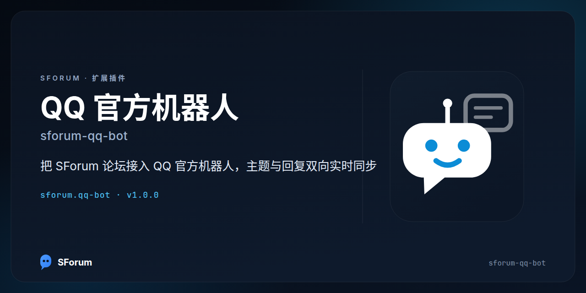

# SForum QQ Bot (`sforum.qq-bot`)

[](https://github.com/keeptrue/sforum-qq-bot/actions/workflows/ci.yml)
[](https://github.com/keeptrue/sforum-qq-bot/releases)



把论坛里的新主题推到 QQ 群，并记下机器人待过的群 ID，省掉运营者手工抄 `group_openid` 的麻烦。
本仓库是**独立插件仓库**，仓库根即 SForum 的**外部扩展源根**，扩展包位于
`plugins/sforum.qq-bot/`。

> **当前状态：`0.4.2`（M1 新帖推送 + M1.1 扫码绑定 / 组件设置页 + M1.2 加固 + M1.3 当前账号卡片与 @ 回复）。**
> 已实现：论坛新主题 → QQ 群单向推送、消息模板与实时预览（可按已保存配置或草稿）、群 ID 自动识别与勾选、
> 手机 QQ 扫码一键绑定并自动写回凭据、设置页预构建组件。
> **未实现**（按任务书裁决延后）：QQ → 论坛的入站回流、频道与单聊分支、投递记录导出 CSV。

## 它做什么 / 不做什么

- **做**：观察宿主 `topic.created`，按模板渲染后推送白名单群；按群计提日额度 + 全局每分钟限速；
  保留最近投递结果与识别到的群 ID，供设置页直接查看与复制。
- **不做**：不读宿主数据库、不自建业务表（摘要走 HostQuery `sforum.core.public_topic.by_id`）；
  不把 QQ 身份当论坛身份（身份映射与回流都在 M2/M3，未启动）；不做频道/单聊。
- **凭据边界**：AppID / AppSecret 只存后台设置项，由宿主以 `SFORUM_SETTING_*` 注入子进程；
  AppSecret 只写不读，日志、投递记录、状态文本里都不会出现。

## 三分钟接入

前置（三件事，缺一件就会卡在对应步骤）：

1. **QQ 开放平台已有机器人**，能拿到它的 AppID（扫码绑定会连同 AppSecret 一起取回）。
2. **插件已在站内启用**：后台 →「扩展管理 → 插件」→ 找到「QQ 机器人」→「启用」。
   带后端的包会由超级管理员确认一次精确制品；**未启用时组件调插件路由会直接报错**
   （页面提示「先在插件列表启用本插件，再回来绑定」）。
3. **已授权可信管理端组件**：同一张插件卡片里的「可信管理端组件」→「授权」→
   按提示输入扩展 ID 与一次性确认码。没授权也能用——宿主会在设置页里给出授权面板
   并回退成声明式表单，功能一项不少，只少了二维码卡片与随改随显示的实时预览
   （见下方「如果只看到表单」）。

然后：

1. 打开插件设置页：侧栏「扩展管理 → QQ 机器人」（该侧栏项需先在顶栏「管理员 ▾ → 系统高级设置」
   里打开「专业模式」，默认关闭），或插件卡片上的「管理」——两条路功能一样。
2. 「绑定 QQ 机器人」卡片 → **「扫码绑定」**。页面出现二维码，并开始倒计时
   （有效期以插件返回的 `expiresInSeconds` 为准，当前实现 10 分钟）。
3. 用**手机 QQ** 扫码，在手机上确认授权。页面每 1.5 秒轮询一次，扫码后提示
   「扫码成功，正在保存凭据…」。
4. AppID 与 AppSecret 自动写回并提交保存，卡片转为「已绑定并保存」。
   当前 AppID 会直接显示出来，AppSecret 输入框保持空白（只写不读）。
   若自动保存没生效，页面会提示「扫码成功，但自动保存没有生效」，此时改在页面底部手动「保存」。
5. 填「群 ID 列表」，每行一个 `group_openid`。**它不是群号**：把机器人拉进目标群，
   或在群里 @ 它一次，再点底部「推送状态」，从「最近识别的群 ID」里复制完整值。
6. 点底部「**发一条测试消息**」。它按**已保存的配置**渲染一条样例并发到白名单第一个群，
   返回「已发送到群 xxx（message id …）」即打通。返回 `ok:false` 时看同一行的中文原因。
7. 去论坛发一篇新主题，群里应收到推送。模板、签名、摘要长度都在设置页里改，
   「消息模板」旁有实时预览（不发送、不保存）。

### 手动填写凭据

不想扫码时，点卡片上的「手动填写凭据」（或直接在表单里填）：

1. 「AppID」照抄平台值；「AppSecret」按掩码输入，**留空表示保留已保存的值**。
2. 保存后回到「推送状态」，凭据一行显示「已配置」即可。
3. 之后按上面第 5 步起继续。

### QQ 侧还有三个前置条件

1. 机器人**已经在目标群里**；
2. 群主在该群打开了「**主动推送消息**」；
3. 到 QQ 开放平台管理端申请**群事件订阅权限**。

第 3 条没批下来时，「最近识别的群 ID」拿不到值，只能手动填群 ID；第 1、2 条缺任何一条，
发送会返回权限类错误，翻译后的中文原因会写进「推送状态」的最近投递里。

### 如果只看到表单，没有扫码卡片

说明预构建组件没被授权（或组件加载失败被宿主隔离）。页面会在表单上方给出
「可信管理端组件」授权面板和一句提示。两条路：

- 点面板的「授权」，按提示输入扩展 ID 与一次性确认码，然后刷新设置页；
- 或继续用表单：手动填凭据，用底部「预览（不发送）」「发一条测试消息」「推送状态」三个按钮。
  表单模式功能一项不少，只是没有二维码和实时预览；组件加载失败时页面还会给
  「使用声明式表单」的切换项，效果相同。

## 常见错误对照表

| 现象（设置页/返回文案） | 原因 | 怎么办 |
| --- | --- | --- |
| 「凭据无效：AppID 或 AppSecret 不正确，或机器人已不存在」 | AppID/Secret 抄错、机器人被删、或换了应用没重配 | 重新扫码绑定，或手动重填后保存，再点「发一条测试消息」 |
| 「主动消息受限：可能群主关闭了「主动推送消息」」 | 群侧没开主动推送，或机器人不在群里 | 找群主开开关；确认机器人已进群 |
| 「该接口需要平台白名单」 | 调了需要平台白名单的接口（如读群状态自检） | 本期不需要该接口；忽略，按群 ID 白名单推送即可 |
| 「消息过长，平台拒绝了本次投递」 | 渲染结果超过平台上限（官方未给具体字数） | 调小「单条消息字数上限」或精简模板；预览里的「已截断」是插件侧提前截断 |
| 投递记录里出现失败原因 `quota_exceeded` | 触达「每群每日上限」（默认 800，平台侧 1000） | 次日自动恢复；或调低推送量、开「暂停推送」止损 |
| 「主动消息已超出频控，请降低推送频率」 | 每分钟发太多（平台频控） | 调低「每分钟推送上限」，超出的消息会排队而不是丢弃 |
| 二维码区域显示「二维码已过期，请重新生成」 | 绑定任务过期（10 分钟） | 点「重新生成二维码」 |
| 「扫码服务暂时不可达，可先手动填凭据」 | 到 `q.qq.com` 的网络不通或平台抖动 | 稍后重试；急用就手动填凭据，绑定流程不影响推送 |
| 「先在插件列表启用本插件，再回来绑定」 | 插件未启用，或保存设置后后端还没重启完 | 启用插件 / 等几秒再刷新 |
| 群里没有任何消息，投递记录为空 | 没有新主题、分类过滤、暂停开关开着、或群 ID 抄成群号 | 用「推送状态」逐项核对：凭据/目标群/暂停/群 ID 识别/队列 |

## 设置项

全部在插件设置页；`secret` 类型只写不读。括号里是存储键名，改代码时按它对接
`SFORUM_SETTING_<大写键名>`。

| 分组 | 设置（键） | 默认 | 说明 |
| --- | --- | --- | --- |
| 连接 | AppID（`app_id`） | 空 | 不是密钥，可照抄；留空则不推送任何消息 |
| 连接 | AppSecret（`app_secret`） | 空 | 只写不读；留空表示保留已保存值 |
| 推送目标 | 群 ID 列表（`group_ids`） | 空 | 每行一个 `group_openid`，`#` 开头是注释 |
| 推送目标 | 只推送这些分类（`category_filter`） | 空 | 分类 slug，每行一个；空 = 全部分类 |
| 推送目标 | 暂停推送（`paused`） | 关 | 应急刹车：停发但继续收事件 |
| 推送目标 | 启用群 ID 自动识别（`enable_group_id_claim`） | 开 | 开长连接记录群 ID；关掉只能手填 |
| 消息模板 | 消息形态（`message_format`） | `text` | `text` 原样发；`markdown` 转义变量值 |
| 消息模板 | 消息模板（`message_template`） | 见下 | 变量：`{{title}}` `{{author}}` `{{category}}` `{{tags}}` `{{excerpt}}` `{{url}}` `{{topicId}}` `{{date}}` `{{signature}}`，也支持中文别名（`{{标题}}` 等） |
| 消息模板 | 摘要长度上限（`excerpt_limit`） | `120` | 0 = 不显示摘要 |
| 消息模板 | 消息签名（`signature`） | `来自 SForum 论坛` | 模板里用 `{{signature}}` 引用 |
| 限速与重试 | 单条消息字数上限（`max_message_chars`） | `1000` | 超长截断并加省略号 |
| 限速与重试 | 每群每日上限（`daily_push_cap_per_group`） | `800` | 平台侧每群每天 1000，留 200 余量 |
| 限速与重试 | 每分钟推送上限（`max_pushes_per_minute`） | `20` | 全局令牌桶，超出排队 |
| 限速与重试 | 失败重试次数（`max_retries`） | `2` | 只对瞬时错误退避重试 |
| 限速与重试 | 单次发送超时（秒）（`send_timeout_seconds`） | `10` | 含取凭据 |
| 排错 | 详细日志（`log_verbose`） | 关 | 只影响日志密度，不含凭据 |

默认模板：

```text
【新主题】{{title}}
作者：{{author}}
分类：{{category}}
标签：{{tags}}
摘要：{{excerpt}}
链接：{{url}}

{{signature}}
```

底部的三个**探测按钮**（保存 / 恢复默认之外的「预览」「测试」「状态」；组件未授权时同样可用）：

- **预览（不发送）**：按页面草稿值渲染，只回渲染结果、是否截断、未知变量名。
- **发一条测试消息**：按**已保存**配置发到白名单第一个群，不写投递记录。
- **推送状态**：只读回报凭据/目标群/暂停/群 ID 识别/队列、长连接状态、最近 10 条投递、
  最近 10 个识别到的群 ID（可直接复制）。

## 安装（服务器侧）

二选一：从 [Releases](https://github.com/keeptrue/sforum-qq-bot/releases) 下载对应平台的 zip，
在后台「插件管理 → 安装插件」上传；或把本仓库挂成外部扩展源（改代码时用这种）。

```bash
# 1. 构建前端产物 + 后端二进制 + 刷新摘要 + 宿主校验（需要 SForum 检出在同级目录）
./scripts/prepare-package.sh

# 2. 让 SForum 扫描到本仓库（仓库根就是外部扩展源根）
#    在 SForum 的 .env 里追加（.env 已被 gitignore）
#    EXTERNAL_EXTENSION_ROOTS=...,/abs/path/to/sforum-qq-bot

# 3. 重启 API（外部源只在启动时扫描），然后
#    后台 → 扩展管理 → 插件管理 → 启用（super_admin 确认精确制品）
```

`prepare-package.sh` 认两个环境变量：`SFORUM_DIR=/path/to/SForum`（默认取同级的 `SForum/`）、
`SKIP_FRONTEND=1`（跳过前端构建）。它会在算摘要前物理删除 `frontend/admin/node_modules`
——宿主算作者树摘要时跳过该目录，而 exact-artifact 校验不跳过，留着必然报
`package digest mismatch after static inspection`。

插件子进程的环境是**白名单**：`HTTP_PROXY` / `HTTPS_PROXY` 不会透传，出站代理只能来自插件自己的设置项。

## 开发闭环

```bash
# 后端单测
cd plugins/sforum.qq-bot/backend && go vet ./... && go test ./...

# 设置页组件：产物（dist）必须入库，宿主不编译前端源码
cd plugins/sforum.qq-bot/frontend/admin && bun install --frozen-lockfile && bun run build

# 回到仓库根，确认 dist 与提交内容一致（有输出就说明产物没提交或构建不可复现）
git status --short plugins/sforum.qq-bot/frontend/admin/dist

# 打包全链路：前端构建 → 后端构建（与 ci.yml / release.yml 同参）→ digest --write → validate → brand check → test
./scripts/prepare-package.sh
```

宿主门禁单独跑（`../SForum` 是本仓库同级的框架检出）：

```bash
cd ../SForum/apps/api
go run ./cmd/sforum extension validate ../../../sforum-qq-bot/plugins/sforum.qq-bot
go run ./cmd/sforum extension test     ../../../sforum-qq-bot/plugins/sforum.qq-bot
go run ./cmd/sforum extension brand check ../../../sforum-qq-bot/plugins/sforum.qq-bot
```

**改任何包内文件都必须重跑 `prepare-package.sh`**：宿主以 exact-artifact 校验哈希，
摘要不匹配的包会被拒绝启用；同版本号只改内容时，卡片上的「重启」不会切换制品，
必须走「升级（授权当前精确制品 → 确认并升级）」。前端 dist 变更同样会让包摘要漂移。

## 目录说明

```text
sforum-qq-bot/
├── docs/                              ← 任务书与调研结论
│   ├── plan-qq-bot.md                 ← 产品任务书（含交付状态回填）
│   ├── qq-api-v2-capabilities.md      ← QQ 官方 API v2 能力盘点（含扫码绑定 lite 附录）
│   └── brand/social-preview.svg       ← 社交卡矢量源
├── plugins/sforum.qq-bot/             ← 扩展包
│   ├── sforum.extension.json          ← Manifest V3：事件 / 路由 / 权限 / AI 工具 / 包文件
│   ├── manifest/settings.json         ← 设置页 schema（组件模式 + 表单回退）
│   ├── manifest/langs/                ← zh-CN / en-US 的扩展名与描述
│   ├── schemas/                       ← 路由与事件的 JSON Schema（契约真源）
│   ├── openapi/routes.yaml            ← 路由的 OpenAPI 片段（把 schema 引用绑到组件）
│   ├── backend/                       ← Protocol V2 服务（独立 Go module）
│   ├── frontend/admin/                ← 设置页组件（Vite + TypeScript，dist 入库）
│   ├── brand/                         ← icon.svg / icon.png / social-preview.png
│   └── README.md                      ← 包级说明
├── scripts/prepare-package.sh         ← 前端构建 + 后端构建 + 摘要刷新 + 宿主校验
├── .github/workflows/                 ← ci.yml（验证）/ release.yml（发版）
├── AGENTS.md  NOTES.md  CHANGELOG.md  README.md  LICENSE
└── .gitignore
```

## CI 与发布

[`ci.yml`](.github/workflows/ci.yml) 在每次推送到 `main` 和每个 PR 上跑：

1. `skeleton`：根级文件、包目录、脚本可执行位、工作流参数化检查。
2. `verify`：检出插件仓库 + 宿主框架（`SFORUM_REF`，默认 `main`）→ 前端
   `bun install --frozen-lockfile && bun run build` 并**比对提交的 dist**（有差异或未提交即失败）
   → 删掉 `node_modules` → `go vet` / `go test` → 构建宿主平台二进制 → 其余平台交叉编译冒烟
   → `extension digest --write` / `validate` / `test`（摘要与提交值不一致只发 notice，不判失败）。

[`release.yml`](.github/workflows/release.yml) 由 `v*` 标签（或手动）触发：`verify` → 四平台 `build`
→ `publish`（`SHA256SUMS` + Release）。要求后端、清单、前端三件齐备，标签版本必须等于清单
`version`，打包前重建前端并校验 dist 与提交内容一致、删掉 `node_modules`，再用
`extension package --exclude-source` 产出 `sforum.qq-bot_<version>_<os>_<arch>.zip`（附 SBOM）。

发布前把 `sforum.extension.json` 的 `version` 提到与标签一致（例如 `0.2.0` ↔ `v0.2.0`）。
Windows 未列入矩阵：宿主按清单 `backend/entry` 直接执行、不做 `.exe` 归一化，未经实机验证前不发布。

## 许可

[MIT](./LICENSE)
